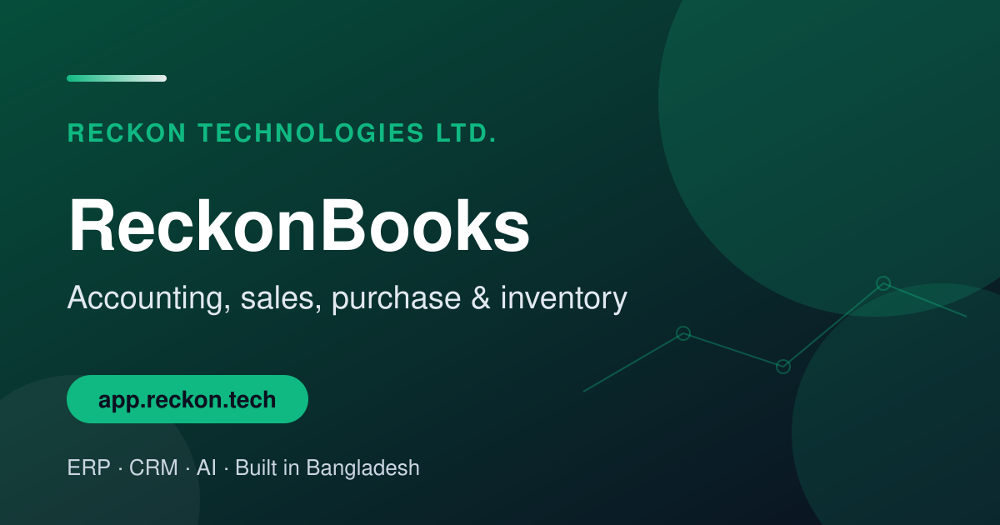

# ReckonBooks: accounting, sales, purchase and inventory for small businesses

ReckonBooks is complete accounting, sales, purchase, inventory and stock management for small businesses, delivered as a subscription through [ReckonERP](https://app.reckon.tech). Each business gets its own company, a home page designed for non-accountants and Tally-style books, so owners can run daily work without learning a full ERP.

## Detailed features

### One company per business
- Every subscribing business works in its own company
- Sales, purchase, stock and accounting records and masters such as customers and items are separated per company
- Cross-company references are refused, so one business never sees another

### Sign up and start in one flow
- Subscribe to the accounts plan, verify by email and SMS, and pay
- The workspace is created and seeded with a walk-in customer, a cash supplier, price lists, a store and a fiscal year

### A home page for non-accountants
- Today's sales, receivables and payables, cash and bank, and stock value
- Quick actions such as Sales Invoice, Receive Payment and Purchase Bill
- Recent documents, items to reorder and a getting-started checklist

### Sales, purchase and stock
- Quotations, sales orders, delivery notes and sales invoices
- Purchase orders, receipts, bills and supplier payments
- Items, warehouses, stock entries and stock counts

### Tally-style accounting
- Voucher entry, a dashboard and 25 Tally-style reports from Reckon Accounts
- ERPNext remains the accounting and stock engine

### Lean forms
- Users see only the fields a small business needs, with a Show all fields button when more is required

### Team and access
- Invite colleagues by email as Company Admin, Company Manager, Accountant, Sales User, Purchase User or Stock User
- Each profile sees only the work it needs

### Bangla and English
- Page text is translatable, with Bangla included

## Built on ERPNext

ERPNext provides the accounting and stock engine and Reckon Accounts provides the voucher entry and reports. ReckonBooks adds the one-company-per-tenant layer, the simple home page, roles and signup flow.

## Who it is for

Shops, traders, service businesses and growing SMEs in Bangladesh that need real accounting with sales, purchase and stock in one place, and want to start by subscribing instead of a long implementation.

## Try ReckonERP

- [app.reckon.tech](https://app.reckon.tech)
- [Sign up for ReckonERP](https://app.reckon.tech/reckonerp-signup)

## Related reading

- [ERP software in Bangladesh: buyer's guide](https://app.reckon.tech/blog/erp-software-in-bangladesh-buyers-guide)
- [How to choose an ERP provider in Bangladesh](https://app.reckon.tech/blog/how-to-choose-an-erp-provider-in-bangladesh)
- [Reckon blog on Hashnode](https://reckonerp.hashnode.dev)
- [Reckon Technologies on LinkedIn](https://bd.linkedin.com/company/reckontech)

## Reckon Technologies Ltd. — ERP, CRM and AI Provider in Bangladesh

Reckon Technologies Ltd. builds ERP, CRM and AI products for businesses in Bangladesh, in Bangla and English.

### Company highlights
- ERP provider with ReckonBooks, distribution and HRMS in Bangla and English
- CRM provider on Frappe CRM
- AI company with Reckon SalesPilot, an AI sales agent
- Industry modules on Frappe/ERPNext: real estate, export-import, distribution, construction, accounts and HR policy
- Guided implementation with Ask Aura AI
- Built in Bangladesh

[app.reckon.tech](https://app.reckon.tech) · [Sign up](https://app.reckon.tech/reckonerp-signup) · [LinkedIn](https://bd.linkedin.com/company/reckontech)

*Topics: accounting software Bangladesh, ReckonBooks, inventory, Tally-style books, ERPNext, Reckon Technologies Ltd, ReckonERP*
